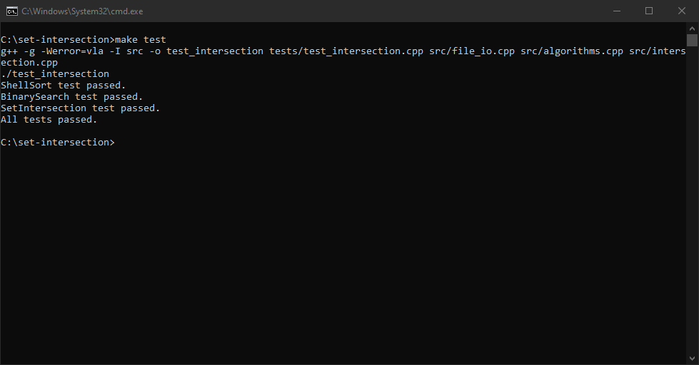
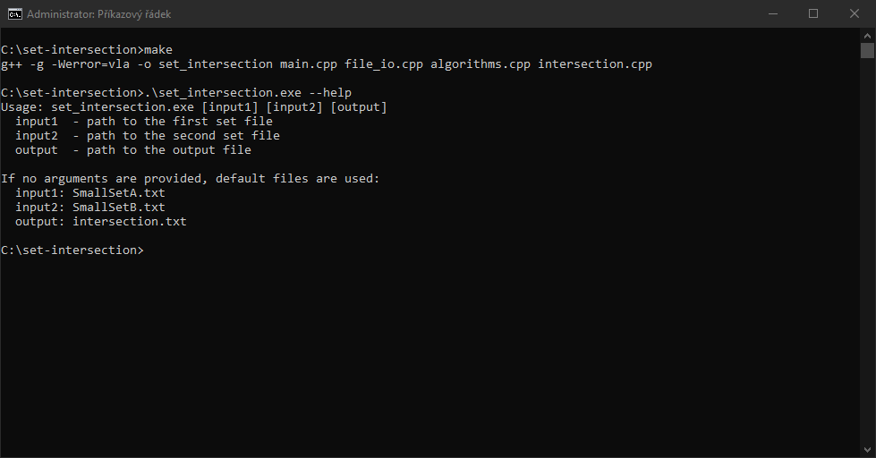
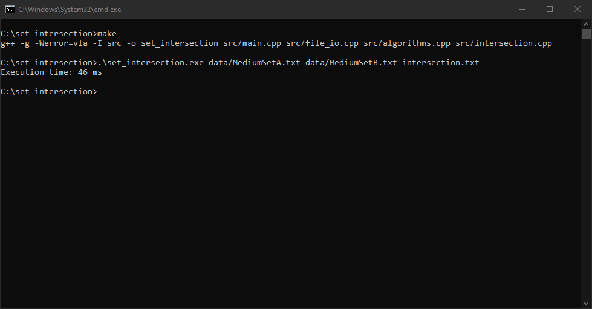
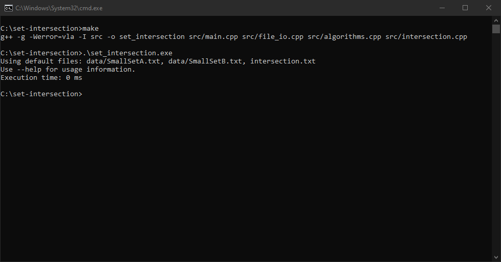

# Set Intersection


![GNU Make](https://img.shields.io/badge/GNU%20Make-000000?logo=)
![Doxygen](https://img.shields.io/badge/Doxygen-244FA7?logo=)

![Emscripten](https://img.shields.io/badge/Emscripten-BAD531?logo=)


Console application that computes the intersection of two sets using Shell sort and binary search algorithms.

## Tech stack

- **Language:** C++
- **Build:** GNU Make
- **Documentation:** Doxygen
- **Library:** xterm.js
- **Web:** WebAssembly, Emscripten
- **Assets:** esbuild
- **Deploy:** Cloudflare Workers

## Website

[Set Intersection](https://set-intersection.mk-forge.workers.dev)

## Features

- Interactive terminal emulator in the browser
- HTTP caching for static assets
- Tab completion for commands
- Clear the console with `cls` or `clear`
- All original CLI commands available (`set_intersection <input1> <input2> [output]`, `set_intersection --help`, `test`, `doxygen`)

## Usage

Default files:
```sh
make && .\set_intersection.exe
```

Custom files:
```sh
make && .\set_intersection.exe input1.txt input2.txt output.txt
```

Help:
```sh
make && .\set_intersection.exe --help
```

## Tests
```sh
make test
```

## Documentation
```sh
doxygen Doxyfile
```

## Screenshots






## License

[MIT](LICENSE)